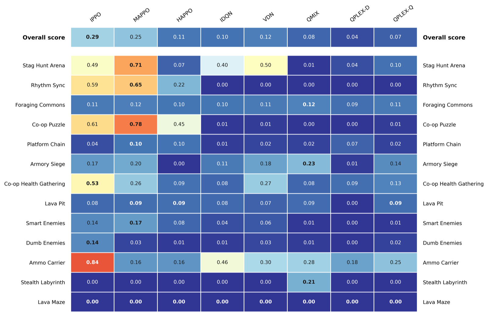
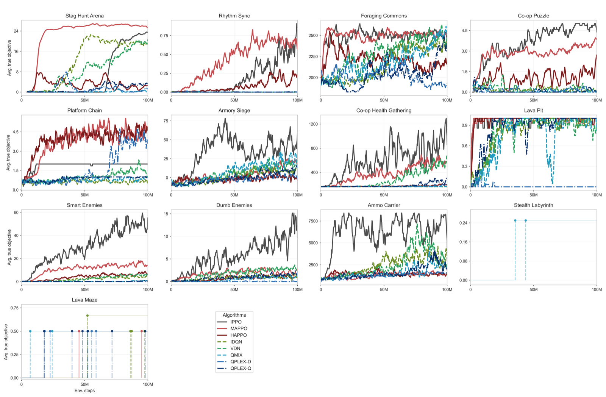
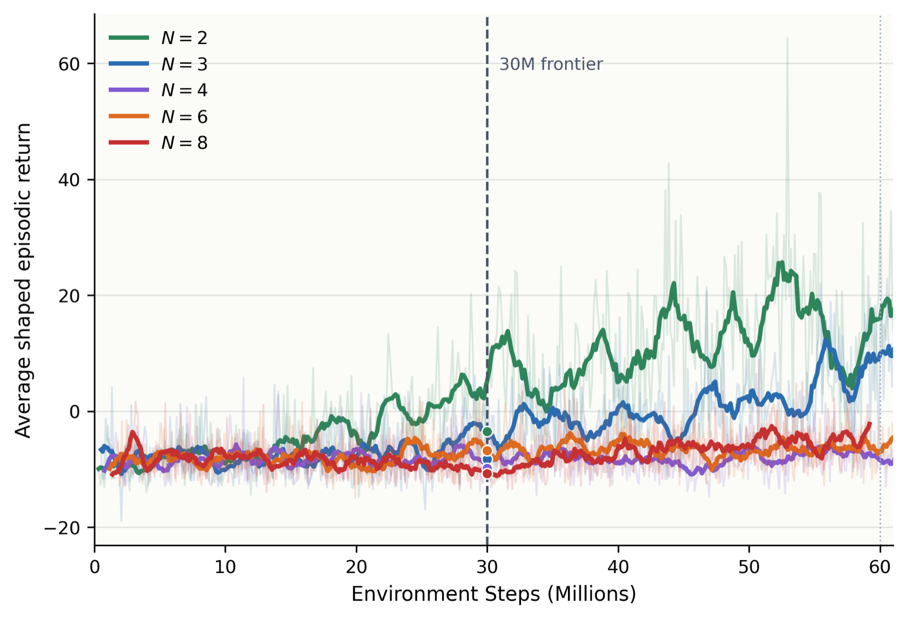
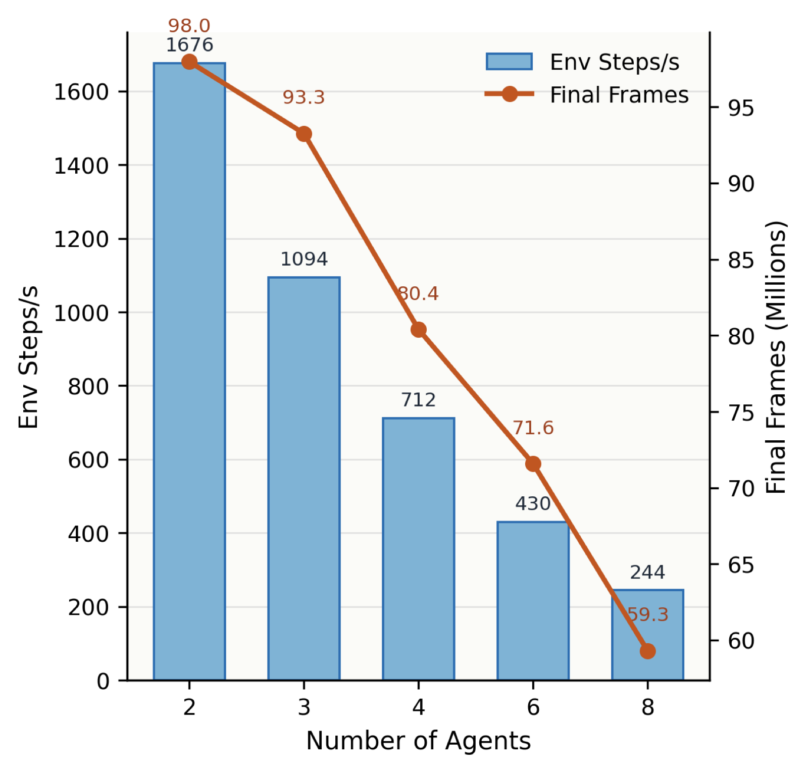

# Baselines

We trained seven MARL algorithms on every scenario with the bundled [Sample Factory trainer](training/sample-factory.md): IPPO, MAPPO, HAPPO, IDQN, VDN, QMIX and QPLEX. Scores are each scenario's `true_objective`. See the paper for the exact protocol.

## Learning curves

## Scaling the team

Armory Siege with 2 to 8 agents (QMIX):

To rerun these experiments, see [Reproducing the paper](training/reproducing.md).
