<h1 align="center"><b>COMRAD: Cooperative multi-agent reinforcement learning from pixels.</b></h1>

<p align="center" markdown>
[🎮 Project Page](https://lmbored.github.io/comrad_site/){ .md-button .md-button--sm }
[:fontawesome-brands-github: GitHub](https://github.com/TTomilin/COMRAD){ .md-button .md-button--sm }
[:simple-pypi: PyPI](https://pypi.org/project/comrad-bench/){ .md-button .md-button--sm }
</p>

COMRAD is a benchmark of 13 first-person cooperative scenarios built on [ViZDoom](https://github.com/Farama-Foundation/ViZDoom). Each scenario isolates one coordination skill: committing to a joint plan, synchronising in time, sharing a commons, swapping roles, or communicating without words.

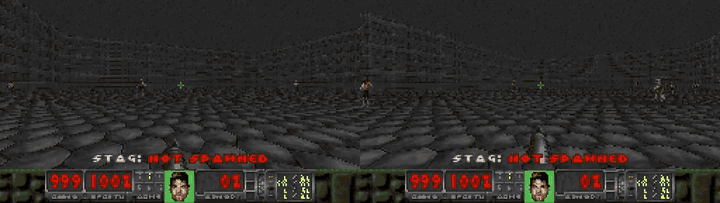

```bash
pip install comrad-bench
```

```python
import comrad

env = comrad.parallel_env("stag_hunt_arena")   # PettingZoo ParallelEnv
observations, infos = env.reset(seed=42)
while env.agents:
    actions = {agent: env.action_space(agent).sample() for agent in env.agents}
    observations, rewards, terminations, truncations, infos = env.step(actions)
```

Works with any MARL library that speaks PettingZoo or Gymnasium. No Sample Factory configuration is needed.

## Scenarios

| | | |
|:---:|:---:|:---:|
| [](scenarios/stag_hunt_arena.md)<br>[**Stag Hunt Arena**](scenarios/stag_hunt_arena.md) | [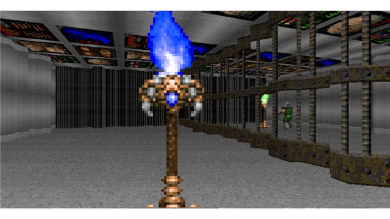](scenarios/rhythm_sync.md)<br>[**Rhythm Sync**](scenarios/rhythm_sync.md) | [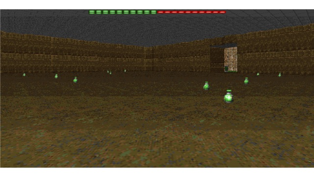](scenarios/foraging_commons.md)<br>[**Foraging Commons**](scenarios/foraging_commons.md) |
| [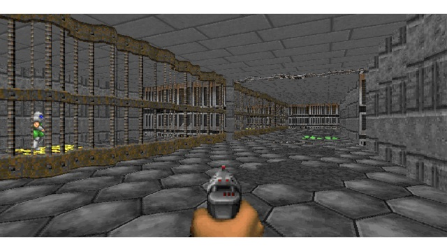](scenarios/coop_puzzle.md)<br>[**Co-op Puzzle**](scenarios/coop_puzzle.md) | [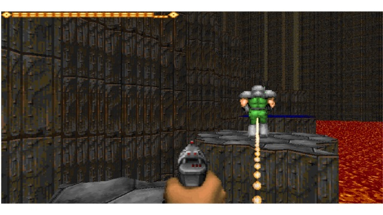](scenarios/platform_chain.md)<br>[**Platform Chain**](scenarios/platform_chain.md) | [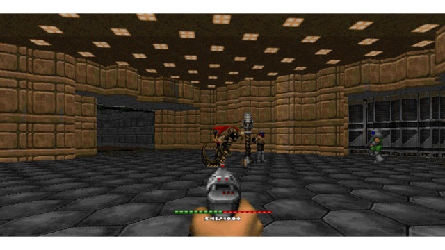](scenarios/armory_siege.md)<br>[**Armory Siege**](scenarios/armory_siege.md) |
| [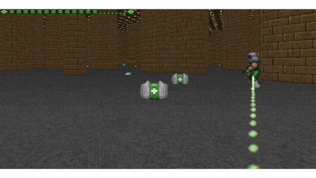](scenarios/coop_health_gathering.md)<br>[**Co-op Health Gathering**](scenarios/coop_health_gathering.md) | [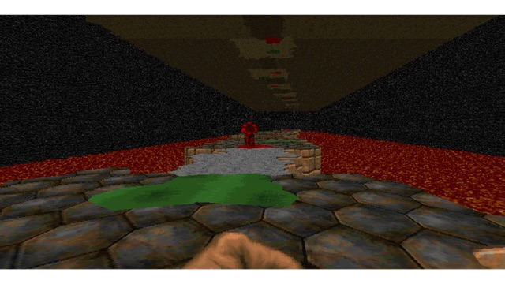](scenarios/lavapit.md)<br>[**Lava Pit**](scenarios/lavapit.md) | [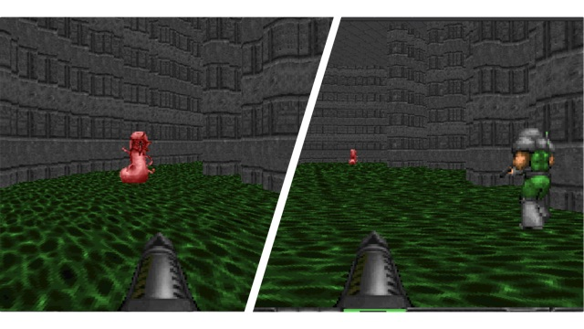](scenarios/smart_enemies.md)<br>[**Smart**](scenarios/smart_enemies.md) / [**Dumb Enemies**](scenarios/dumb_enemies.md) |
| [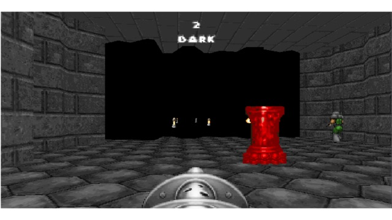](scenarios/stealth_labyrinth.md)<br>[**Stealth Labyrinth**](scenarios/stealth_labyrinth.md) | [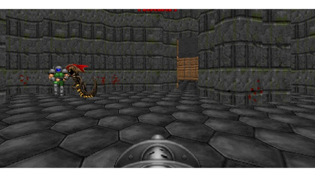](scenarios/ammo_carrier.md)<br>[**Ammo Carrier**](scenarios/ammo_carrier.md) | [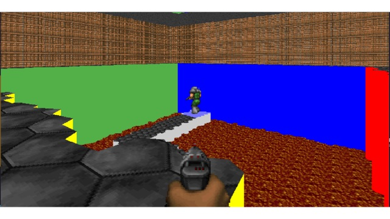](scenarios/lava_maze.md)<br>[**Lava Maze**](scenarios/lava_maze.md) |

## Where to next

- [Installation](getting-started/installation.md) and [Quickstart](getting-started/quickstart.md): run a scenario in a minute.
- [Scenarios](scenarios/index.md): what each task tests and how it is scored.
- [API reference](api.md): options, spaces, info keys and episode semantics.
- [Sample Factory baselines](training/sample-factory.md): train IPPO, MAPPO, HAPPO, IDQN, VDN, QMIX or QPLEX with the bundled trainer.
- [Baselines](baselines.md): results of the seven reference algorithms.
- [Project page](https://lmbored.github.io/comrad_site/): playable demo, scoreboard and paper overview.
