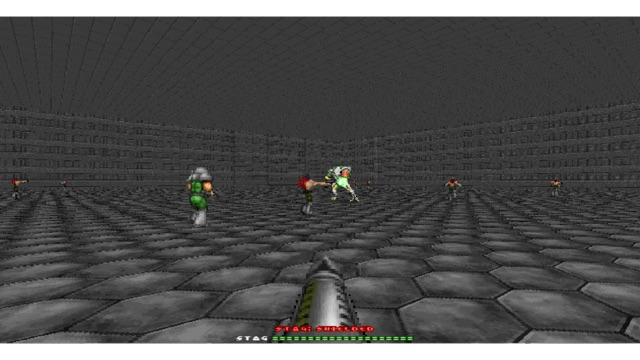

# Stag Hunt Arena



A stag-hunt coordination dilemma. Rabbits give a small, reliable reward to a single hunter. The shielded stag pays much more, but it can only be brought down when the hunters commit to it together. Tests whether policies find the payoff-dominant cooperative equilibrium instead of the safe one.

```python
import comrad

env = comrad.parallel_env("stag_hunt_arena")
```

| | |
|---|---|
| Gymnasium id | `comrad/stag_hunt_arena-v0` |
| Agents | 2 by default (supports 2–4) |
| Capability tested | Convention formation, trust, equilibrium selection |
| Episode limit | 4500 steps |
| Observation | RGB image `(72, 128, 3)` per agent; measurement vector not available |
| Action space | `Tuple(Discrete(3), Discrete(3), Discrete(3), Discrete(2))` |
| Default `shared_reward` | `0.0`: each agent receives its own reward |
| Score (`info["true_objective"]`) | Stags killed |

## Actions

Each agent sends one choice per head; index `0` is always "do nothing".

0. move: none / forward / backward
1. strafe: none / right / left
2. turn: none / left / right
3. attack: none / attack

## Reward

Per agent: +3 per rabbit, +50 per stag, a small bonus for new stag damage (only new lowest stag HP within one stag life); penalties for health loss and death.

The score in `info["true_objective"]` is what the benchmark reports. The shaped reward is only a training signal.

## Variants

- `stag_hunt_arena_continuous`: continuous turning head.
- `stag_hunt_arena_continuous_full`: continuous move, strafe and turn heads.
